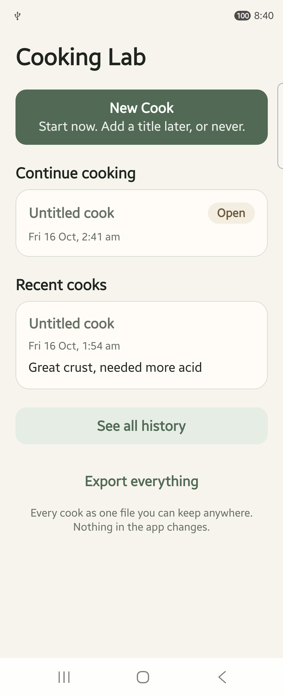

# Both apps carry the new icon, on the Fold

16 October 2026. Built and installed from `1cd5c3b` — *an icon of its own: a
notebook page with a thermometer, in sage and amber*.

Both packages were updated in place. Neither was uninstalled, and no data was
cleared.

## What the screenshot shows


The app drawer on the Fold's **cover screen** (968 × 2376; the Fold was folded,
so the inner screen was off). The last row holds the two apps side by side,
ahead of the one unrelated app that sorts after them:

- **Cooking Lab** — a cream notebook page with ruled lines, an amber
  thermometer standing against it, on the app's sage background.
- **Cooking Lab Test** — the same drawing, with a red `TEST` tag across the
  foot of the page.

A close-up of the two:


The tag reads clearly at launcher size, which is what it is for: the two apps
are told apart at a glance, so a real cook never goes into the TEST sandbox by
mistake. One small thing to note, not a fault: the launcher truncates the TEST
app's label to "Cooking Lab…", so the icon's tag — not the name — is what
distinguishes them on screen.

## Versions and signing

| | TEST | Production |
|---|---|---|
| Package | `com.cookinglab.personal.test` | `com.cookinglab.personal` |
| versionCode | 2 (was 1) | 2 (was 1) |
| versionName | 0.1.0 | 0.1.0 |
| Signer | `CN=Android Debug` (as intended) | `CN=Cooking Lab` |
| ABI | arm64-v8a | arm64-v8a |

The production APK's signer was checked with `apksigner verify --print-certs`
**before** it was installed: `Signer #1 certificate DN: CN=Cooking Lab`. The
release key was read from the building machine's Gradle properties, never from
this tree.

That the in-place update succeeded at all is the second proof of the signature:
Android refuses to update an installed app whose new APK is signed with a
different key, so `adb install -r` would have failed rather than replaced
version 1.

## Data kept

`firstInstallTime` is unchanged for both packages, which is the device's own
record that neither was uninstalled and reinstalled:

| | firstInstallTime | lastUpdateTime |
|---|---|---|
| TEST | 2026-09-03 14:27:44 (unchanged) | 2026-10-16 20:32:12 |
| Production | 2026-10-16 19:38:32 (unchanged) | 2026-10-16 20:38:33 |

The TEST app was then opened to see its data rather than infer it:



Home lists the synthetic cooks from before the update — an in-progress
"Untitled cook" under *Continue cooking*, and a finished one under *Recent
cooks* still carrying its note, "Great crust, needed more acid". The encrypted
database and its key both survived the update.

The production app was not opened. It holds real cooking data, and nothing
needed opening it: its `firstInstallTime` is unchanged and its update was
accepted against the existing signature, which together say the sandbox was
kept. Its own icon is visible in the drawer screenshot above.

## How it was built

Each variant was prebuilt clean, so neither inherited the other's generated
native project:

```
APP_VARIANT=test npx expo prebuild --clean --platform android
cd android && ./gradlew assembleRelease -PreactNativeArchitectures=arm64-v8a
adb install -r app/build/outputs/apk/release/app-release.apk
```

then the same without `APP_VARIANT` for production, with the `apksigner` check
between the build and the install.

One snag worth recording for the next device run: the Fold reports two internal
displays, so `adb exec-out screencap -p` refuses to pick one and writes a
warning into the PNG stream, corrupting the file. The display must be named —
`screencap -d <display> -p` — and the id comes from
`adb shell dumpsys SurfaceFlinger --display-id`, not from the logical display
number, which `screencap` rejects.
