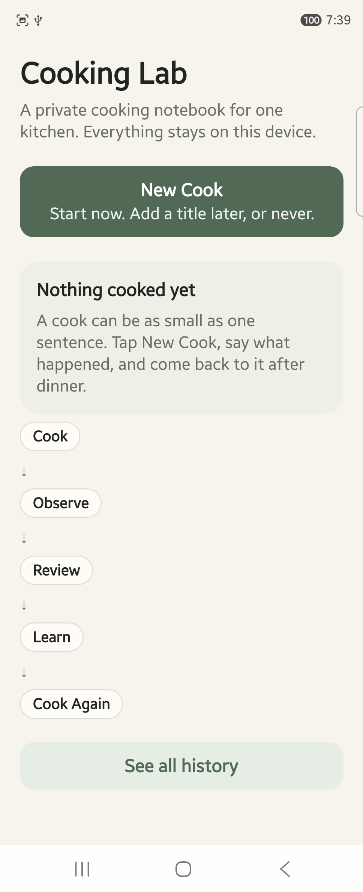

# Slice 2b — production signing, and the real Cooking Lab on the Fold

16 October 2026. Cooking Lab now has its own release key. The production
variant was built, signed with that key, installed on the Fold, and launched.
Cooking Lab Test is untouched and still installed beside it.

## Commit built

`cf5e934` — *feat: slice 2b — production builds are signed with Cooking Lab's
own key*, the tip of `main` after a fast-forward pull. The working tree was
clean before and after.

## The key

Generated with `keytool -genkeypair` into a PKCS12 keystore in a folder outside
the repository, in Mike's user profile. Nothing about where it lives is written
down here or anywhere in the tree.

| | |
| --- | --- |
| Alias | `cooking-lab` |
| Key type | RSA, 4096-bit |
| Signature algorithm | SHA384withRSA |
| Certificate | self-signed, `CN=Cooking Lab` |
| Validity | 10,000 days — from 16 October 2026 to 3 March 2054 |

`keytool -list -v` on the finished keystore reports one entry, a
`PrivateKeyEntry` under alias `cooking-lab`, owner and issuer both
`CN=Cooking Lab`. That is the whole keystore: one key, nothing else.

The passphrase was never typed into a shell and never appeared in any command
output. Mike pasted it into a scratch file, which was read straight into the
two `keytool -storepass:file` / `-keypass:file` arguments and into
`gradle.properties`, and then deleted. Its absence was confirmed before the
build: the keystore folder now holds the `.jks` and nothing else.

## Where the build gets the key

`%USERPROFILE%\.gradle\gradle.properties` — outside the repository, read
automatically by Gradle — now carries the four properties
`plugins/withReleaseSigning.js` requires:

| Property | Holds |
| --- | --- |
| `COOKING_LAB_STORE_FILE` | absolute path to the keystore, forward slashes |
| `COOKING_LAB_STORE_PASSWORD` | the passphrase |
| `COOKING_LAB_KEY_ALIAS` | `cooking-lab` |
| `COOKING_LAB_KEY_PASSWORD` | the passphrase |

The file already held unrelated Gradle settings; those were left as they were
and the four lines appended. Nothing was overwritten.

## Build

Production variant — no `APP_VARIANT`, so `app.config.ts` takes its default:

```bash
npx expo prebuild --platform android --clean
cd android
./gradlew assembleRelease --max-workers=2 -PreactNativeArchitectures=arm64-v8a
```

`prebuild` regenerated `android/` from scratch and the config plugin re-applied
the signing rule as designed. In the generated `android/app/build.gradle` the
release build type reads `signingConfig signingConfigs.release`; the debug key
is used only by the debug build type.

`BUILD SUCCESSFUL in 6m 14s`, 580 tasks. The APK came out at about 47 MB,
`applicationId 'com.cookinglab.personal'`.

### Signer

This is the check the whole slice exists for —
`apksigner verify --print-certs` on the release APK:

```
Signer #1 certificate DN: CN=Cooking Lab
```

One signer, Cooking Lab's own certificate. Not `CN=Android Debug`. (The
fingerprints `apksigner` prints alongside are deliberately not reproduced
here.)

## Install and launch

`adb install` of the release APK onto the Fold, unlocked and awake — a fresh
install, as `com.cookinglab.personal` had never been on the device. `Success`.
Afterwards `pm list packages` shows both identities side by side:

```
package:com.cookinglab.personal
package:com.cookinglab.personal.test
```

Two packages, two Android sandboxes, no collision — which is the point of the
separate application ids.

Launched with `am start -n com.cookinglab.personal/.MainActivity` and
screenshotted on the Fold's cover display, the built-in screen that was on at
the time (the inner screen was off; the capture names its display explicitly,
because `screencap` with no display warns that its default is not stable).



What the screenshot shows:

- The title is **Cooking Lab**, not Cooking Lab Test.
- **No TEST badge** beside the title, and **no TEST notice** anywhere on the
  screen.
- The empty state: *Nothing cooked yet*, and the invitation to tap New Cook.
  A fresh sandbox with no data in it, which is what a first install should be.
- The loop — Cook → Observe → Review → Learn → Cook Again — and *See all
  history* below it.

Nothing was tapped. This is the app as it comes up on first launch.

## Checks

| Check | Result |
| --- | --- |
| `npm run check:secrets` | run before the push; nothing key-shaped found |
| `npm run typecheck` | clean, no diagnostics |
| `npm run lint` | clean, no findings |
| `npm test` | 576 tests in 31 suites, 576 passed, 0 failed |

## What Mike still has to do

**Back up the keystore.** Explorer was opened on the folder that holds it.
That one file is the only thing that can sign an update to the installed app:
lose it and the only way back is to uninstall Cooking Lab and lose its data.
It belongs somewhere off this PC, with the passphrase kept separately.
